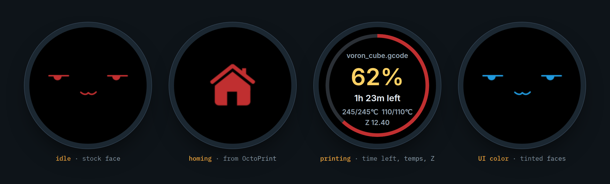
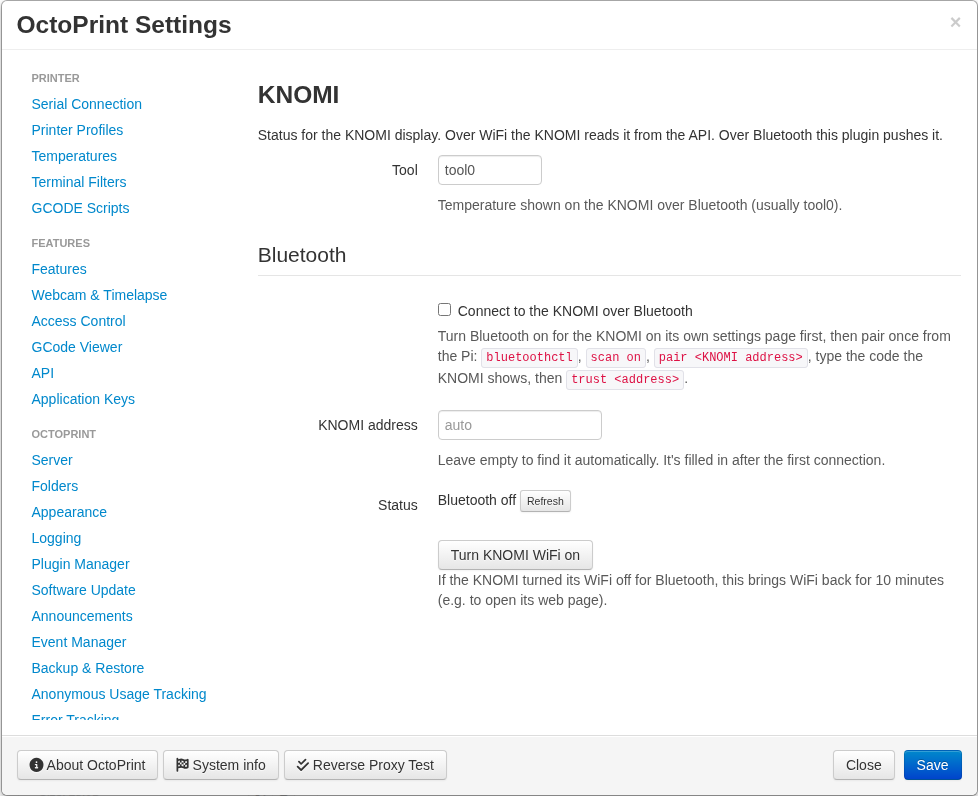

# OctoPrint-KNOMI: BTT KNOMI display plugin for OctoPrint

**OctoPrint plugin for the BigTreeTech KNOMI / KNOMI 2 round display** (the Voron Stealthburner screen). With the **[KNOMI for OctoPrint firmware](https://github.com/Binnacle-Tech/KNOMI)**, it makes the KNOMI show what an OctoPrint printer is doing, including OctoPrint + Klipper (OctoKlipper) setups. Mainsail/Moonraker isn't needed.

<p align="center"></p>

> [!IMPORTANT]
> **Only tested on a KNOMI 2 with OctoPrint on a Raspberry Pi 5.** Other setups should work but are untested. Reports are welcome.

## What it adds

- **Homing, probing / bed mesh, QGL, input shaper, PID tuning, nozzle cleaning, filament change and pause animations** on the KNOMI, driven by what OctoPrint is actually doing:
  - commands OctoPrint sends (`G28`, `QUAD_GANTRY_LEVEL`, `BED_MESH_CALIBRATE`, `M109`/`M190`, `SHAPER_CALIBRATE`, `PID_CALIBRATE`, `CLEAN_NOZZLE`, `LOAD_FILAMENT`, `PAUSE`/`M600`, and so on)
  - `// KNOMI <flag>=1` lines from your Klipper macros, so steps inside `PRINT_START` show up too ([`knomi_octoprint.cfg`](knomi_octoprint.cfg))
  - `// action:paused` / `// action:resumed`
- **Signals for Coaster, the KNOMI firmware's mascot:** filament runout (`M600` or a runout message), the part cooling fan speed (`M106`/`M107`) and the speed factor (`M220`), so it can look hungry, squint into the wind or hang on.
- **Display messages.** `M117`, `SET_DISPLAY_TEXT MSG=…` and `// action:notification` lines are passed to the KNOMI, where Coaster says them in a speech bubble (also available as `{msg}` in the print screen designer).
- **Coaster in your OctoPrint sidebar.** A live mirror of the KNOMI's Coaster: its mood, how it's feeling, its seasonal hat and the last print's report card (screams, peak g, dizzy spells). While the panel is open the KNOMI also sends where its head and pupils are a few times a second, and which quirk it's doing, so the sidebar moves with the real one (close, not frame-exact). Needs KNOMI firmware OP16 or newer (feelings: OP23, live motion, quirks and decorations: OP25).
- **Filament type for the KNOMI.** Read from the slicer's settings in the file (`filament_type`, the filament preset) or the file name, so Coaster can react to PLA, PETG, ABS, ASA, TPU, nylon or PC. Needs KNOMI firmware OP28 or newer.
- **Current layer and Z for the KNOMI.** OctoPrint doesn't report layers, so the plugin reads the file being printed, finds where each layer starts (slicer layer comments, or Z moves followed by extrusion) and follows OctoPrint's file position, the same way the G-code viewer does. This drives the KNOMI's layer triggers, `{layer}` and `{z}`. Files printed from OctoPrint's own storage only. Needs KNOMI firmware OP20 or newer.
- **Bluetooth LE link.** The plugin connects to the KNOMI directly, pushes status the moment it changes, sends the file list, and runs the KNOMI's touchscreen buttons inside OctoPrint. No API key, no polling.
- **The KNOMI network** (KNOMI firmware OP58+). The KNOMI runs its own small WiFi network and the Pi joins it on a spare WiFi interface, using details it gets over the paired Bluetooth link. The KNOMI's pages, GIF uploads and firmware installs go over it, much faster than Bluetooth. The KNOMI never joins your WiFi.
- **The KNOMI's settings and pages in OctoPrint.** Every KNOMI setting, its print screen designer, animations, Coaster page and log, under Settings › KNOMI. Firmware updates too: the Pi downloads the release and sends it over.
- No G28 or bed-mesh macro overrides are needed, so it avoids the "Macro G28 called recursively" and KAMP problems of the stock KNOMI macros.

## Install

OctoPrint → Settings → Plugin Manager → **Get More…** → **…from URL**:

```
https://github.com/Binnacle-Tech/OctoPrint-KNOMI/archive/refs/heads/main.zip
```

Restart OctoPrint when asked. Then flash the OctoPrint build of the **[KNOMI firmware](https://github.com/Binnacle-Tech/KNOMI)** (`knomiv2-octoprint-firmware.bin`) on the KNOMI.

<p align="center"></p>

## Setup

1. **Pair.** Settings › KNOMI › Bluetooth: tick **Connect to the KNOMI over Bluetooth**, **Find KNOMI**, **Pair**, and type the 6-digit code the KNOMI shows. No `bluetoothctl` needed. If the Pi's Bluetooth is disabled (`dtoverlay=disable-bt`, common on Klipper setups using the GPIO UART), remove that line from `/boot/firmware/config.txt` and reboot first.
2. **The KNOMI network** (optional, recommended). The Pi needs a WiFi interface that isn't on your own network:
   - **Pi on Ethernet:** its built-in WiFi is free once it stops joining your WiFi. The plugin shows the `nmcli` command for that, with your network's name filled in. Run it over SSH while on Ethernet.
   - **Pi on WiFi:** add a USB WiFi adapter, or skip this and stay on Bluetooth only (pages and uploads are slower).

   The first time, the plugin shows a one-time command that lets NetworkManager accept OctoPrint's user. Run it over SSH and the Pi joins by itself; **KNOMI network** then says *joined*. The plugin never takes a WiFi interface that's on, or could rejoin, another network, or that carries the Pi's internet. Pick one by hand under **WiFi interface** if you want to.

Needs Raspberry Pi OS Bookworm or newer (NetworkManager) for the KNOMI network. Bluetooth works without it.

### Upgrading to KNOMI firmware OP58

OP58 moves the KNOMI off your WiFi. Update this plugin first (0.14.0+), make sure Bluetooth says *connected*, then install OP58 from Settings › KNOMI. The plugin picks up the KNOMI's new network over Bluetooth. If anything goes wrong, the KNOMI shows a QR code after 2 minutes without Bluetooth: join its network from a phone and open `http://192.168.77.1/`. More in the firmware's [upgrade notes](https://github.com/Binnacle-Tech/KNOMI/blob/octoprint/OCTOPRINT.md#upgrading-to-op58).

## Updates

OctoPrint's **Software Update** keeps the plugin current: it checks GitHub for new commits on `main` and shows
**Update now** under Settings › Software Update (and a notification). After the first install, updates are one click.
The first check after installing may offer an update even if you're current; installing it records the version.

Settings › KNOMI › **Update the KNOMI** updates the KNOMI's firmware: from GitHub (the Pi downloads the right file for the KNOMI's board and build) or from a `.bin` you pick. The KNOMI won't install a firmware file meant for the Moonraker build.

## FAQ

**Does the KNOMI need Mainsail or Moonraker with this?** No. With this plugin and firmware, the KNOMI works with OctoPrint alone.

**Does the KNOMI need to be on my WiFi?** No. Since firmware OP58 it isn't: Bluetooth is the control link, and its own network carries pages and uploads.

**What does the permission command do?** It adds a polkit rule letting OctoPrint's user ask NetworkManager to set up and switch connections, which joining the KNOMI's network needs. Delete `/etc/polkit-1/rules.d/50-octoprint-knomi.rules` to take it back.

**Does it work with OctoKlipper?** Yes, that's the tested setup: OctoPrint + OctoKlipper on a Raspberry Pi 5.

**What's the API endpoint?** `GET /api/plugin/knomi` returns the status flags (`homing`, `probing`, `qgling`, `heating_nozzle`, `heating_bed`, `shaping`, `pid_tuning`, `cleaning`, `filament`, `paused`, `runout`) plus `fan` (part cooling fan %), `speed` (speed factor %), `msg`/`msg_id` (last display message) and, during a print, `layer`, `layers` and `z` (µm). Changes are also sent as plugin messages on the websocket.

## License

AGPL-3.0, see [LICENSE](LICENSE). Not affiliated with BIGTREETECH.
